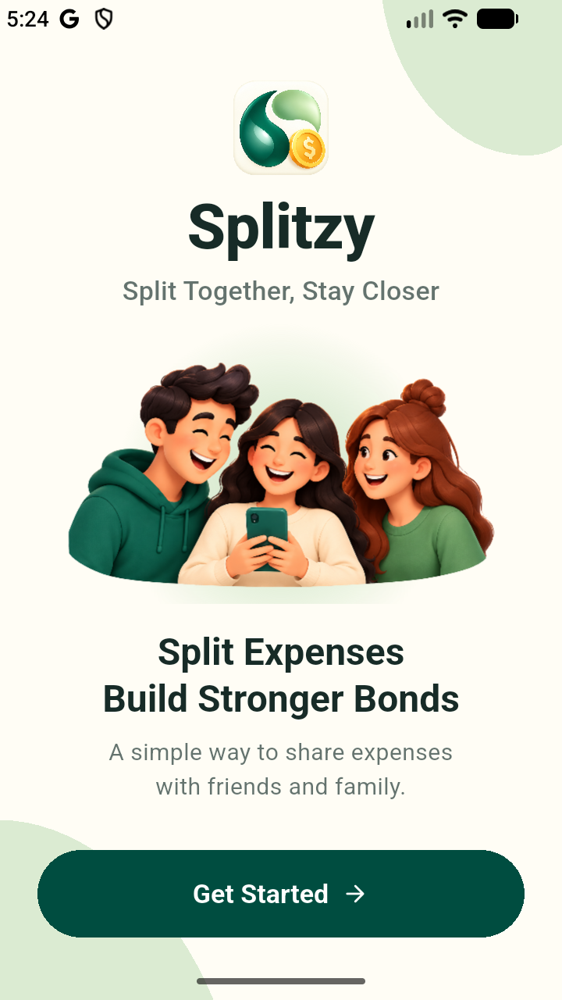
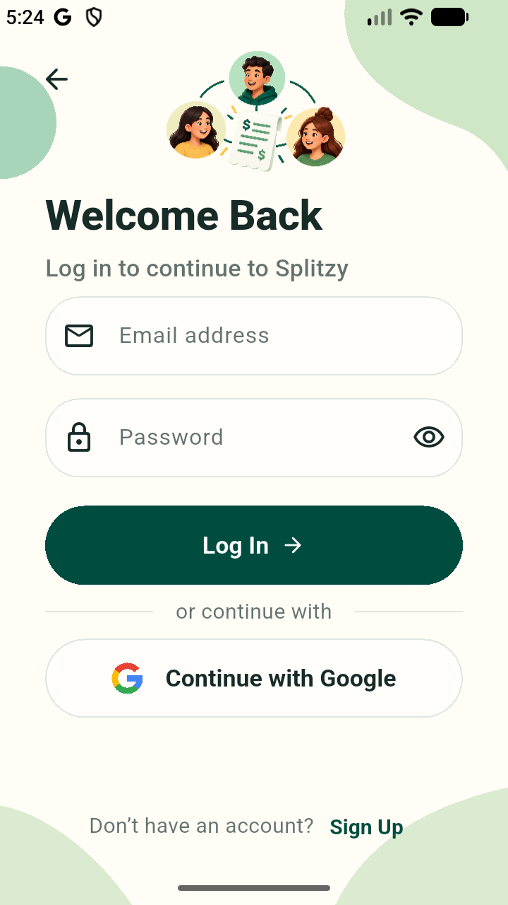
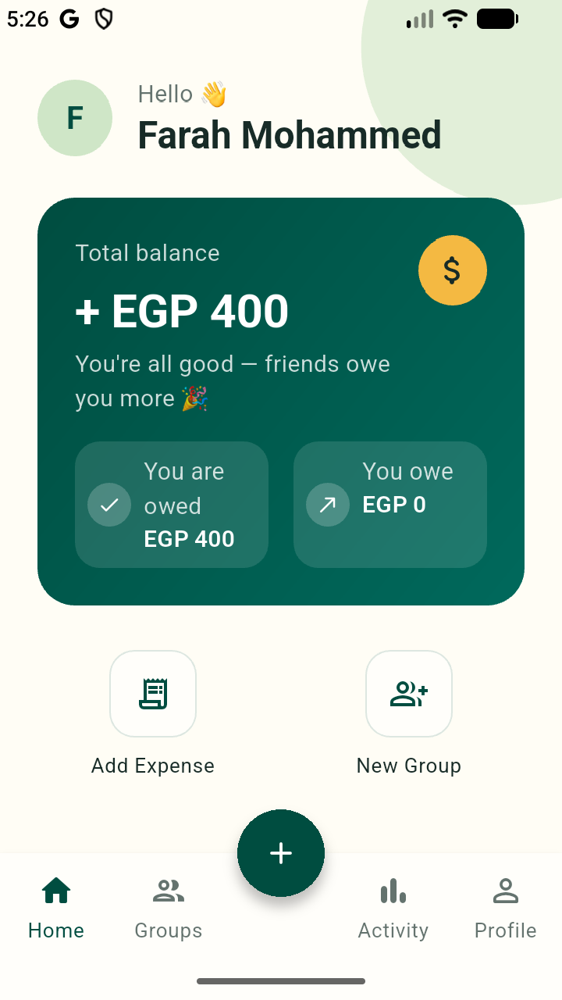
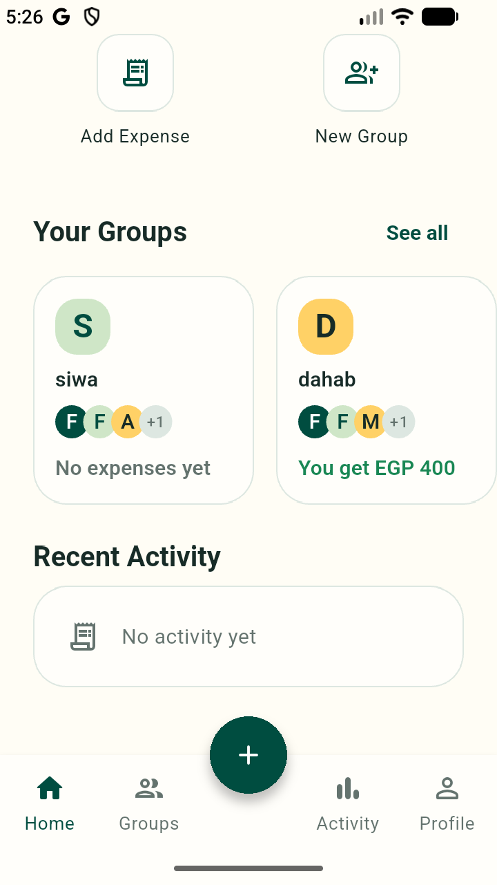
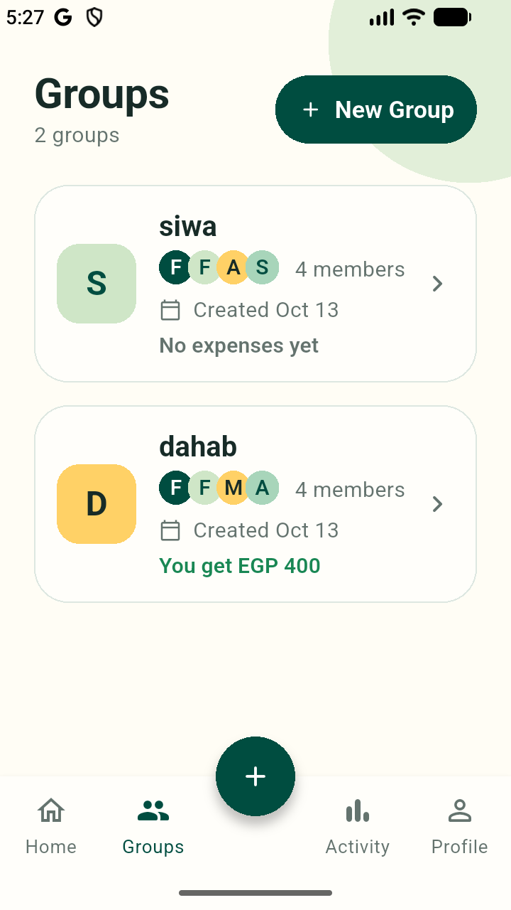
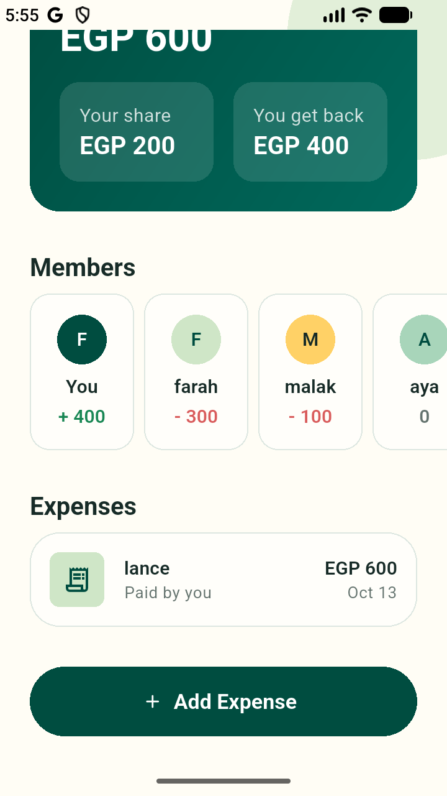
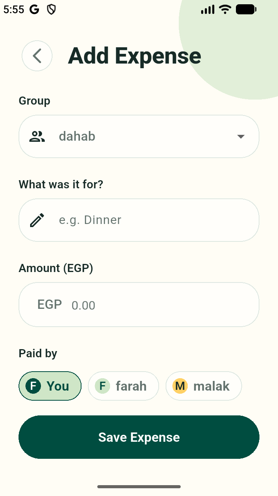
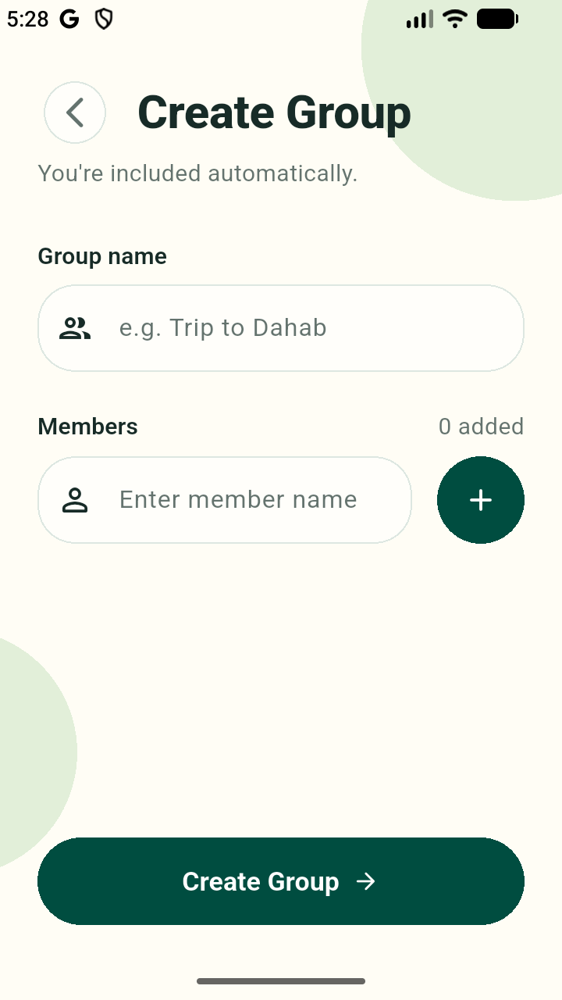

# Splitzy

**Split together, stay closer.** Splitzy is a Flutter app for sharing expenses
with friends: create a group, record who paid for what, and see who owes whom.

Built with Flutter, Riverpod and Firebase, following Clean Architecture, with
579 automated tests.

---

## Screenshots

| Splash | Log in | Home | Home: your groups |
|:---:|:---:|:---:|:---:|
|  |  |  |  |

| Groups | Group details | Add expense | Create group |
|:---:|:---:|:---:|:---:|
|  |  |  |  |

---

## Features

- **Accounts**: sign up and log in with email and password or with Google; a
  profile tab with log out.
- **Groups**: create a group and add its members (2–50 people, you included);
  see every group with its members and your balance in it.
- **Expenses**: record what was paid, by whom, and how it is split:
  - **equally** between all members, or
  - **by custom amounts** that must add up to the total.
- **Group page**: the group's total, your share, what you get back or owe,
  every member's balance, and the expenses, newest first.
- **Home**: your overall balance across all groups (what you are owed and what
  you owe) and your groups at a glance.
- Loading, empty and error states on every screen; layouts checked on small
  phones, large text and tablets.

---

## Money rules

- Money is never a `double`: amounts are stored as **integer piastres**
  (EGP 150.50 is `15050`), so calculations are exact.
- Currency: EGP. An expense is between EGP 0.01 and EGP 1,000,000, paid by one
  member.
- **Equal split**: the amount is divided between all members; leftover
  piastres go one each to the first members in the order they joined
  (EGP 100 between three is 33.34 / 33.33 / 33.33).
- **Custom split**: every share is zero or more, and the shares must add up to
  the amount exactly.
- **Balance** = what a member paid − their shares. Positive means they are owed,
  negative means they owe; a group's balances always add up to zero.
- All of this is pure Dart in the domain layer and covered by unit tests.

---

## Tech stack

| Concern | Choice |
|---|---|
| UI | Flutter 3.38 (Dart 3.10), Android |
| State management | Riverpod 3 with `riverpod_generator` |
| Navigation | GoRouter (auth-aware redirects) |
| Backend | Firebase Authentication, Cloud Firestore, Crashlytics |
| Sign-in | Email/password and Google Sign-In |
| Models | Freezed + json_serializable |
| Tests | flutter_test + mocktail |

---

## Architecture

Clean Architecture, one folder per feature:

```
lib/
  main.dart, app.dart, injection_container.dart   # app start and wiring
  core/        # shared: theme, router, errors, money formatting, widgets
  features/
    auth/      # sign in, sign up, profile
    groups/    # create and list groups
    expenses/  # add expenses, balances, group page
    home/      # Home screen
```

Each feature is split into layers, and dependencies point inward:

```
presentation  ──►  domain  ◄──  data
```

- **domain**: pure Dart — entities, business rules (splits, balances,
  validation) and repository interfaces. No Flutter or Firebase.
- **data**: Firestore and Firebase Auth code; turns SDK errors into app errors.
- **presentation**: screens and Riverpod providers. Each route has a *Page*
  (connects Riverpod) and a *Screen* (layout only, easy to test).
- `injection_container.dart` creates the Firebase-backed implementations once
  and hands them to Riverpod, so tests can swap in fakes.

---

## Firestore and security

```
groups/{groupId}                ownerId, name, members [{id, name}], createdAt
groups/{groupId}/expenses/{id}  description, amount (piastres), currency,
                                paidBy, splitType, shares {memberId: piastres},
                                createdAt
```

[`firestore.rules`](firestore.rules) lets a signed-in user read and create only
their own groups and those groups' expenses, checks every field and limit, and
denies editing and deleting. Balances are computed on the device and never
stored.

---

## Getting started

The Firebase configuration files are **not** in this repository (it is public),
so you need your own Firebase project:

1. Install Flutter 3.38 and an Android emulator or device.
2. Create a Firebase project and add an Android app with the package name
   `com.splitzy.app`.
3. In Firebase Authentication, enable **Email/Password** and **Google**. For
   Google sign-in, register your debug key's SHA-1 and SHA-256 fingerprints.
4. Create a **Cloud Firestore** database, then paste [`firestore.rules`](firestore.rules)
   into *Firestore Database → Rules* and publish.
5. Generate the configuration files with the
   [FlutterFire CLI](https://firebase.google.com/docs/flutter/setup):
   ```
   flutterfire configure
   ```
   This creates `lib/firebase_options.dart`, `android/app/google-services.json`
   and `firebase.json`.
6. Run the app:
   ```
   flutter pub get
   flutter run
   ```

After changing a Freezed model or a Riverpod provider, regenerate the generated
files:

```
dart run build_runner build --force-jit
```

---

## Testing

```
flutter analyze
flutter test
```

579 tests cover the money rules (splits, balances, amount parsing), validation,
the data layer (with mocked Firestore), every screen's states and layouts
(small phones, 2× text, tablets) and navigation, including the auth redirects.
Tests never use real Firebase.

---

## Limitations and future work

- **Settlements** (recording that someone paid back) are not built yet.
- Groups and expenses cannot be **edited or deleted** yet.
- The **Activity** tab shows "Coming soon", and Home's **Recent Activity**
  always shows "No activity yet".
- **Offline use**: adding a group or an expense waits until the connection is
  back.
- Groups belong to the user who created them; sharing a group with other
  registered users is planned.
- **Forgot Password**, search and notifications are not built yet.
- The app uses the default Flutter launcher icon.
